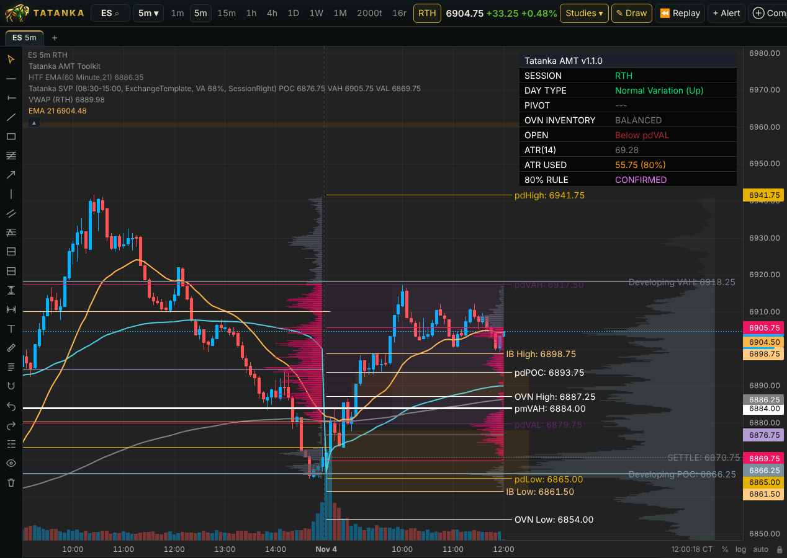

# Tatanka Charts

Self-hosted charting server: live futures charts (time, tick, volume, range bars), daily levels, watchlists and
server-side alerts, in a browser on desktop and phone. One user per install. Never places orders.



*Loaded up on purpose to show a lot at once: the AMT Toolkit and its dashboard, session volume profiles, VWAP, EMAs. Every
study turns on and off on its own, so a chart can be as clean as you like. Simulated data.*

Futures trades come from the NinjaTrader add-on, or from other feeds (Interactive Brokers, Databento, a program of
your own, or a feed plugin anyone can write). Watchlist quotes come from NinjaTrader, IBKR, Alpaca, Coinbase and
Yahoo. A fresh install runs on a simulator until a feed is connected.

## Run it

You need [Git](https://git-scm.com/downloads) and [Docker Desktop](https://www.docker.com/products/docker-desktop/)
(on Windows it sets up WSL 2 when it installs; start it once and wait until it says it is running). For live futures,
NinjaTrader 8 or another feed (Connections, after the first run); without one the app runs on its simulator.

The code lives in the public repository tatankatrading/tatanka-charts. Clone it anywhere:

```
git clone https://github.com/tatankatrading/tatanka-charts.git
```

Then start it with Docker (the commands below). `.env` is your copy of `env.example`: the server runs without editing
it; later you can fill in the alert channels there, and the folders on the PC the server uses (Host folders): your
Documents folder (levels files, files to backfill), where your Databento downloads are, and the backups folder
(`BACKUP_DIR`; keep it private: the backups hold your keys). Mac or Linux: `cp env.example .env`.

```
cd tatanka-charts
copy env.example .env
docker compose up -d --build
```

Documents in OneDrive (Windows' folder backup; File Explorer shows Documents under OneDrive) is not
`C:\Users\<you>\Documents`: PowerShell's `[Environment]::GetFolderPath('MyDocuments')` gives the folder to put in
`DOCUMENTS_DIR`. A backups folder inside OneDrive goes to OneDrive too, keys and all.

Without Docker (Python 3.11+), in a virtual environment of its own (`.venv`: current Linux and Homebrew's Python
refuse a `pip install` outside one). Windows:

```
cd tatanka-charts\server
python -m venv .venv
.venv\Scripts\python -m pip install -r requirements.txt
.venv\Scripts\python -m uvicorn chartsrv.app:app --host 127.0.0.1 --port 8800 --loop asyncio
```

Mac or Linux:

```
cd tatanka-charts/server
python3 -m venv .venv
.venv/bin/python -m pip install -r requirements.txt
.venv/bin/python -m uvicorn chartsrv.app:app --host 127.0.0.1 --port 8800 --loop asyncio
```

Open http://127.0.0.1:8800. API docs: http://127.0.0.1:8800/api/docs. Tests: `python -m pip install pytest`, then
`python -m pytest -q tests`, in `server` with the `.venv` python above.

**First run.** A fresh install opens on the simulator (invented trades, so everything works before a feed is
connected) and a short setup guide:

1. A password.
2. Where your futures trades come from: keep the simulator, or **Leave the simulator**. That deletes its invented
   trades (a copy of the database is kept next to it, so the disk needs room for one) and restarts on NinjaTrader and
   the feeds under Futures feed.
3. Alerts and quotes.

**Not now** ends it; every step is in Connections too. An install that already has data or settings never sees it.
To show it again: `docker compose exec chart python -m chartsrv.setup again`. **Leave the simulator** is also on the
NinjaTrader card in Connections while the simulator runs.

**Secure by default.** On a fresh install, while no password is set (none yet, or Login turned off later), only the
PC itself may use the app: a phone through Tailscale gets "Set a password on the PC first".
`CHART_REMOTE_NEEDS_PASSWORD=0` in `.env` lets other devices in without one (Tailscale is then the only lock).

## Updating

On Windows, double-click **`update.cmd`** in the `tatanka-charts` folder, or run it there (Command Prompt: `update.cmd`;
PowerShell: `.\update.cmd`; Mac or Linux: `./update.sh`). It gets the newest
version (`git pull`), rebuilds and restarts the server (`docker compose up -d --build`) and copies the NinjaTrader
add-on into NinjaTrader, keeping the Host, Port and Token set in your copy. NinjaTrader compiles it by itself when
its NinjaScript Editor is open; otherwise New > NinjaScript Editor, F5. Your own edits to its files (such as
`config/holidays.json`) are put back on the new version; where the update changed the same lines (or removed the file),
its version is used and yours is kept (`git stash show -p` shows it).

What happens by itself after that, or whenever something changes:

- **Open pages and the phone app reload** when the server's version changes (once you're not mid-drawing or typing).
  No Ctrl+Shift+R, no closing the phone app.
- **Settings apply when saved.** Connections restart only the feed that changed; a saved instrument list restarts the
  server in place and every page comes back by itself.
- **Feed plugins load while it runs.** A file added to `feeds/`, changed, or removed shows in Connections within a few
  seconds; connections using it restart on the new code.
- **Packages a plugin needs** install from its card: **Install** (they stay through updates).
- **Imports** (backfill, Databento): the server restarts itself a minute after one ends, so charts show the history.
- **Any CME future charts on demand.** Open RTY, ZN, 6E... (search, type it, or click it in a watchlist): it's added
  live with its last 90 days from NinjaTrader. No Instruments step, no restart.
- **Holidays never run out.** Years `config/holidays.json` doesn't list follow CME's usual pattern by themselves.
- **Low disk** turns the Backups card red and sends an alert a day, before new trades stop being saved.
- **The app opens instantly**, from the copy saved on the device (phone or PC); an update replaces it and reloads once.
- **Daily, weekly and monthly charts of a future just added** start with years of history (Yahoo's older days; not on the simulator).
- **The database is tidied** each day in the 16:00 CT break; trades are kept 5 years (Backups card), bars always.
- **An older NinjaTrader add-on** is flagged on its card, with the steps and a download.
- **A newer version on GitHub** shows as a note on open pages and on Connections > Updates, with what changed.

## Documentation

| | |
|---|---|
| [Phone and PC app](docs/PHONE.md) | the app on iPhone, Android and Windows over Tailscale; login |
| [NinjaTrader](docs/NINJATRADER.md) | the add-on: install, gap fill, rollover |
| [Data feeds](docs/FEEDS.md) | more brokers and data vendors, your own program, writing a feed plugin |
| [Connections](docs/CONNECTIONS.md) | every feed, key and alert channel; instruments; backups |
| [Charts](docs/CHARTS.md) | chart types and controls, studies, drawings, replay, footprint, big trades, your fills |
| [Tatanka indicators](docs/INDICATORS.md) | AMT Toolkit, TPO, volume profiles, Gap Analysis, HTF EMA, Daily SMA, If/Then, Level Lines |
| [Watchlists and symbols](docs/WATCHLIST.md) | watchlists, symbol search, free data (FRED, EIA, COT, calendar) |
| [Alerts and Discord](docs/ALERTS.md) | alerts and where they go; posting charts to Discord |
| [Market data](docs/DATA.md) | backfill, Databento import, exchange holidays |
| [Contributing](docs/CONTRIBUTING.md) | code layout, tests and checks, what is not built yet |

Charts are drawn with [Lightweight Charts](https://github.com/tradingview/lightweight-charts) 5.1 by TradingView
(Apache 2.0), vendored in `web/vendor/`.
